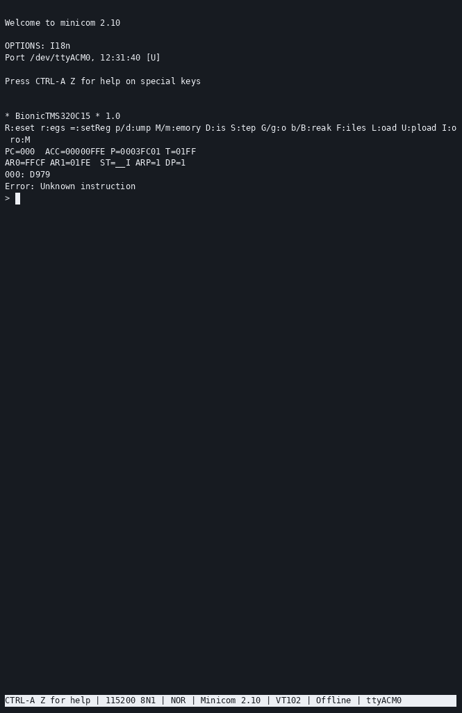

# Debugger

The controller presents a single-letter command REPL over USB serial, built on
[libcli](https://github.com/tgtakaoka/libcli). Connect at **115200 8N1**.

<div align="center">

<br><em>A <a href="https://asciinema.org/a/723753">TMS320C15 session</a> running the
same Mandelbrot program as every other target.</em>
</div>

## Commands

From the header of `debugger/debugger.cpp`:

| Key | Action |
|---|---|
| `R` | Reset CPU |
| `r` | Print CPU registers |
| `=` | Set a CPU register |
| `d` | Dump data memory — `addr [length]` |
| `p` | Dump program memory — `addr [length]` |
| `m` | Read/write data memory |
| `M` | Read/write program memory |
| `c` | Fill data memory — `addr n v...` |
| `C` | Fill program memory |
| `P` | Show/set the target's memory area |
| `D` | Disassemble |
| `A` | Assemble |
| `S` | Step one instruction, printing bus cycles |
| `G` | Go — run continuously — `[n]` backtrace lines after stopping (default: all) |
| `g` | Go until address — `addr [n]`, same backtrace |
| `B` | Set breakpoint |
| `b` | Show/clear breakpoints |
| `U` | Upload Intel HEX or Motorola S-record |
| `L` | Load Intel HEX or S-record file from SD card |
| `F` | List files on SD card |
| `O` | Mount a disk image — `drive file` mounts it on that drive, `drive` unmounts, Enter lists; `sync` and `cache [on\|off\|through\|back]` drive the [disk cache](#disk-cache) |
| `Y` | YMODEM a file onto or off the SD card — `put [file [offset [size]]]`, `get file [offset [len]]`; `crc file [chunk]` lists its CRC-32s, `rm file` deletes |
| `I` | Show/select I/O device — `dev [addr [vec]]` also sets its base and interrupt vector |
| `W` | Write identity EEPROM |
| `V` | Toggle verbose mode |
| `?` | Print version and usage |

Separate `d`/`p` and `m`/`M` pairs exist because Harvard-architecture targets have distinct
program and data address spaces. `P` sets an area of the target's memory
space, which the target names and gives its meaning: the Z86's protect
area, write-protected ROM, or the V20/V30's 8080EMU area, which holds 8080
code. It works only on targets that report `hasProtectArea()`; elsewhere
it prints `No area`.

On a CPU clocked from a timer (see [hardware.md](hardware.md#clocking-the-cpu)),
`K [kHz]`, which `?` doesn't list, shows the clock rate a run uses or sets it;
a rate the CPU can't take is answered with `?clock: not taken`. On a bus the
debugger clocks edge by edge, such as the MC9S12D's, `K` scales the bus cycle's
delays instead, as if the part ran at that rate: its rated clock leaves them
as built.

### Not in a stock build

`debugger/config_debugger.h` controls what is compiled in. By default:

```c
#define ENABLE_SDCARD
// #define WITH_ASSEMBLER
#define WITH_DISASSEMBLER
```

So the **disassembler is present but the assembler is not**. `U` — upload over the serial
link — and `L`, from the SD card, get code in. Enable the assembler by uncommenting and
rebuilding; the firmware has room to spare.

## Verbose mode

`V` toggles printing of captured bus cycles. With it on, `R` and `S` show every cycle the
CPU performed, which is the whole point of the machine:

```
R A=0100 D=0002
W A=0100 D=0001
0500: 16FD    JNE  >04FC
04FC: DE41    MOVB R1, *R9+
R A=0102 D=0000
```

`R` marks a read the controller answered, `W` a write it captured. The instruction lines
come from the built-in disassembler.

## Registers

There is no debug port on a 1975 processor. Registers are recovered by **injecting
instructions** — the controller feeds the CPU a short sequence and captures what appears on
the bus. The same mechanism, run in reverse, writes them.

The same mechanism drives runtime variant detection — the firmware executes instructions
that behave differently on each die and reads back the result. See
[supported-cpus.md](supported-cpus.md) for which targets report which variants.

After every register dump the next instruction is disassembled automatically.

## Breakpoints

Four user breakpoints plus one temporary, used by `g` (go until address) —
`debugger/break_points.h`. They are implemented by patching a trap instruction into program
memory and restoring the original bytes afterwards; each target picks its own, for example
`RST 38H` on Z80.

## Memory

Emulated memory lives in the Teensy's RAM (`debugger/mems.cpp`):

| Region | Size | Backing |
|---|---|---|
| `DmaMemory` | 128 kB | `DMAMEM` |
| `ExtMemory` | 16 MB | `EXTMEM` — the Teensy 4.1's optional PSRAM |

Byte- and word-addressed CPUs are both supported, in either endianness, and the listing
radix can be octal for the PDP-8 targets. What a target leaves of `EXTMEM` above its
address space holds the [disk cache](#disk-cache).

## I/O devices

`I` lists the emulated peripherals and selects the console one. `I dev addr` moves a
device in the address map, and `I dev addr rx [tx]` also sets its Rx and Tx interrupt
vectors (Tx defaults to Rx; 0 asserts no interrupt). The base reads back as the listing
prints it, however many digits. A program can set the vectors too, by writing them to
the device's third and fourth registers. These are the board's wiring, so `R` leaves them
alone; a reset clears only the device's own registers and pending interrupts.

- **MC6850 ACIA** — `debugger/mc6850.cpp`
- **i8251 USART** — `debugger/i8251.cpp`
- **DL11** (DCT11, DCJ11) — `debugger/pdp11/dl11.cpp`: the console at 177560, its
  vectors being the Rx and Tx interrupt names. `I DL11 177` masks each character to 7
  bits, as a console terminal's line was: Unix sends each character with a parity
  bit, which the terminal would have ignored. `I DL11 377` passes all 8 again.
- **KW11-L** (DCJ11) — `debugger/pdp11/kw11l.cpp`: `KW11L`, the 60 Hz line clock at
  177546, which `I KW11L` turns off and on. Its interrupt is the CPU's #EVENT.
- **RK11** (DCJ11) — `debugger/pdp11/rk11.cpp`: `RK11`, a disk controller at 177400
  with eight RK05 drives, vector 220, which `I RK11` turns off and on. The drives are
  image files on the Teensy's SD card. `L dcj11/unix_v6.hex` loads a bootstrap and
  mounts the slots of `unix_v6.dsk` beside it as rk0 up: 1024 blocks of 512 bytes for
  a drum, then 6144 blocks a drive, the layout of TangConsoleDCJ11MEM's disk images,
  and only that layout, with one to eight drives. `O rk1 pack.dsk` mounts a single
  RK05 pack's file, up to 2494464 bytes, on a drive and `O rk1` unmounts it. [Unix V6](samples.md#unix-v6-on-the-dcj11) installs
  itself on that disk.
- **MSCP** (DCJ11) — `debugger/pdp11/rq.cpp`: `MSCP`, an RQDX3 disk controller at
  172150, vector 154, which `I MSCP` turns off and on; `debugger/pdp11/mscp.cpp` is
  the controller itself, which `test/test_mscp` runs on the host. Its four units,
  ra0-ra3, are image files on the SD card, each as large as its file, which the
  controller reports as the unit's size; `O ra0 disk.dsk` mounts one and `O ra0`
  unmounts it. `L x.hex` mounts `x.dsk` as ra0 and `x<n>.dsk` as ra<n> beside it, as
  an image of any other size than the RK11's goes to the MSCP controller; the other
  controller's drives are unmounted. [2.11BSD](samples.md#211bsd-on-the-dcj11) boots
  from `L dcj11/bsd211.hex`.
- **SWR** (DCJ11) — `debugger/pdp11/swr.h`: `SWR`, the console switch register at
  177570. `I SWR 173030` sets what it reads; that value, the default, starts Unix
  single-user.
- **Address mask** (Z380) — `debugger/z380/devs_z380.cpp`: `AMASK`, one port at
  0148H holding the number of address lines memory decodes, 32 after a reset. A 64K
  system writes 16, and an access above FFFFH then lands in its 64K.
- **Sector disk** (8080, 8085, Z80 family, 8086 family) — `debugger/sector_disk.cpp`:
  `DISK`, a paravirtual CP/M disk 10H above the USART: port 50H, or 0150H on the Z180,
  Z280 and Z380. A command moves one sector while the CPU waits; DMAX (+7) extends DMA
  past 64K. Four drives are image files on the SD card, in the target's formats:
  `ibm-3740` (8" floppy, any image up to 256256 bytes) or `hd8` (exactly 8 MB). Other
  sizes are refused. DRIVE reads back the drive's format in bits 4-7.
  `L i8080/cpm80.hex` mounts `cpm80.dsk` and `cpm80b.dsk`-`cpm80d.dsk` beside it as
  A-D; `O B work.dsk` mounts a single drive and `O B` unmounts it; `I DISK` turns the
  disk off and on. Each mount prints the drive's line as `O` lists it, such as
  `A    ibm-3740  i8080/cpm80.dsk`, and each drive dropped prints `B unmounted`.
- **8087 INT** (D8087 board) — `debugger/i8086/devs_d8087.cpp`: `NPX`, disabled at
  power-up, `I NPX` turns it on and off. While the 8087 holds INT high it requests
  interrupt type 2 by default, which raises NMI and stops the run in the debugger;
  `I NPX 0 type` makes it raise INTR with that type instead.

For microcontroller targets with a serial port on the die, that port is bridged to your
terminal instead of an emulated chip. Handlers exist for CDP1802, INS8060, INS8070, i8051,
i8085 SIO, MC6801, MC68HC11, MC68HC05C0, TLCS-90, TMS7002, Z86 and Z88.

## Files on the SD card

`F` lists the card, `L` loads a HEX/S-record file from it and `O` mounts disk
images (see [I/O devices](#io-devices)). `Y` moves whole files between the card
and the host by YMODEM over the same console, while the CPU is halted:

- `Y put` then start a YMODEM upload in the terminal (minicom: `Ctrl-A S`,
  `ymodem`, the file); the card file takes the sender's name, in the card's
  root. `Y put path` names it instead, directories made on the way. The file
  is replaced: it ends where the received data does.
- `Y get path` then start a YMODEM download (`Ctrl-A R`, `ymodem`); the file
  arrives under its own name.
- `Y crc path` prints the file's size and the CRC-32 of each 4 KB chunk
  (zlib's), eight to a line after the offset of the first.
- `Y rm path` deletes a file; one a drive has mounted stays, and so do
  directories.

The board waits a minute for the transfer to start, and `^C` at the prompt
cancels it. A mounted disk image goes through the handle its drive holds, so
`Y put` refreshes an image in place with nothing out of step. The optional
numbers are hexadecimal: `Y put path offset` writes the received data at
`offset` and leaves the rest of the file alone, `offset size` also cuts the
file to `size`, `Y get path offset len` sends that slice, and `crc`'s `chunk`
is the chunk size (at least 200). Those serve `scripts/bionic-control.py`:
`sd put LOCAL REMOTE` and `sd get REMOTE LOCAL` move a file, checked by its
CRCs, `sd rm REMOTE` deletes one, and `sd sync LOCAL REMOTE` sends only the chunks whose CRC differs,
the cheap way to refresh a disk image of several MB with a few blocks
changed. The host side is lrzsz's `sb` and `rb`, which minicom uses too.

## Disk cache

Disk images are read and written through a cache of 512-byte blocks in the part
of `EXTMEM` the target's memory does not use (`debugger/disk_cache.cpp`, behind
`debugger/disk_image.cpp`): 15 MB on a 1 MB target such as the 8086 or Z180,
12 MB on the DCJ11, all 16 MB on the 8080 and 8085, whose memory is elsewhere.
A target that uses all 16 MB, such as the 68000, Z280 or Z380, lends nothing and
reads and writes the card directly. Drives sharing an
image file share its blocks. A sector read that hits costs no card access; a
miss reads the block in. A mount reads the image into the cache as far as the
free blocks go, about a second for 10 MB: the drive's line then ends in `cached`
when all of it is in, or in the MB that are, such as the first 11.8 MB of a 159 MB
BSD image, the rest filling on demand. `O`
lists the cache after the drives:

```
  cache 11.8 MB write-through: 4096 hits, 120 misses, 0 dirty
```

Writes follow one of two policies, write-through at power-up:

- `O cache through`: a sector write goes to the card at once, as it would
  without the cache, and only reads are served from memory.
- `O cache back`: a written block stays in memory, dirty, and reaches the card
  when the CPU stops (the halt switch, a breakpoint, `S`), when a full set has
  to evict it, when its drive is unmounted, or on `O sync`. The controller's own
  flush, after each CP/M sector or RK11 and MSCP command, writes nothing then,
  so an OS `sync` followed by the halt switch still leaves everything on the
  card by the time the prompt returns. Power loss, a watchdog reboot or a reflash
  before the CPU stops loses the dirty blocks: use write-back for a session you
  will stop at the prompt, and expect a stop after much writing to take seconds.
  A block the card refuses stays dirty and is retried by the next sync; the
  prompt says `disk: 3 blocks not written to dcj11/bsd211.dsk`.

`O cache` shows the state, `O cache off` and `O cache on` turn the cache off
(writing dirty blocks first) and on for the session, and `O sync` writes the
dirty blocks and reports. A file's length is kept exact: a block written at the
end of a 256256-byte CP/M image extends the file by the sector, never to a
block boundary. `Y put` writes the card directly and drops the blocks it
overwrites; `Y rm` leaves a mounted image alone.

## Bus-cycle capture

`debugger/cycles.h` keeps a 128-entry ring of captured cycles, each recording the address,
the data, and whether the controller injected or captured it.

## Halting a running program

`G` runs the CPU freely. To get back, press the **HALT/RUN** switch on the base board, or
send any character on the second USB serial port — the software HALT. Both raise
`Pins::isrHaltSwitch()`.

After stopping, `G`/`g` disassemble the run — an optional `n` argument caps that backtrace
to the last `n` lines (`0` prints none of it), which keeps a long run's dump from scrolling
its real output off screen. Leave `n` empty for the long-standing default of printing all of
it.
